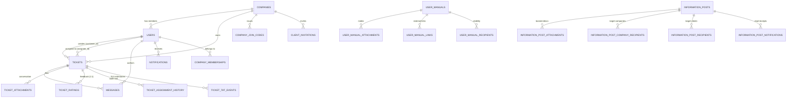

# Jishnu Infotech Support Portal — Full Database Schema & Project Blueprint

**Project Repository:** `C:\Users\HP\.gemini\antigravity\scratch\jishnu-infotech-support`  
**Database Engine:** PostgreSQL 18.6 (Production: `129.121.128.205:5432`)  
**Backend:** Node.js 24 + Express 5.1  
**Frontend:** React 19 + TypeScript 5.9 + Vite 7  

---

## 1. High-Level Architecture & Entity Relationship Diagram



---

## 2. Complete Database Schema (All 28 Tables)

### Table 1: `companies`
Primary enterprise client accounts.
| Column | Type | Constraints / Default | Description |
|---|---|---|---|
| `id` | `bigint` | `PRIMARY KEY` | Auto-increment unique company ID |
| `name` | `text` | `NOT NULL` | Registered company trade name |
| `slug` | `text` | `NOT NULL UNIQUE` | URL-safe identifier |
| `domain` | `text` | `NULLABLE` | Company email domain (e.g. `client.com`) |
| `is_active` | `integer` | `DEFAULT 1 NOT NULL` | `1` = Active, `0` = Suspended |
| `support_valid_until`| `date` | `NULLABLE` | Annual maintenance / SLA contract expiry |
| `internal_consultant_id` | `bigint` | `NULLABLE` | Dedicated account manager consultant |
| `created_at` | `timestamp` | `DEFAULT UTC` | Registration timestamp |

---

### Table 2: `users`
Master user accounts covering all roles: Client, Company Admin, Consultant, Super Admin.
| Column | Type | Constraints / Default | Description |
|---|---|---|---|
| `id` | `bigint` | `PRIMARY KEY` | User ID |
| `username` | `text` | `NOT NULL UNIQUE` | Case-sensitive sign-in handle |
| `name` | `text` | `NOT NULL` | Full legal/display name |
| `email` | `text` | `NULLABLE UNIQUE` | Contact email address |
| `contact_number` | `text` | `NULLABLE` | Phone / Mobile number |
| `password_hash` | `text` | `NOT NULL` | Bcrypt hashed credential |
| `role` | `text` | `NOT NULL` | `'client'` or `'agent'` (consultant) |
| `is_admin` | `integer` | `DEFAULT 0 NOT NULL` | `1` = Super Admin (Jishnu Infotech) |
| `is_company_admin` | `integer` | `DEFAULT 0 NOT NULL` | `1` = Company Admin (Client enterprise) |
| `company_id` | `bigint` | `REFERENCES companies(id)` | Primary associated company |
| `is_internal_consultant` | `integer`| `DEFAULT 0 NOT NULL` | Flag for dedicated internal staff |
| `internal_routing_priority` | `integer`| `DEFAULT 0 NOT NULL` | Weighting for auto-assignment |
| `routing_priority` | `integer` | `DEFAULT 0 NOT NULL` | Global round-robin priority score |
| `specialty` | `text` | `DEFAULT 'both'` | `'functional'`, `'technical'`, or `'both'` |
| `approval_status` | `text` | `DEFAULT 'approved'` | User approval workflow state |
| `disabled_at` | `timestamp` | `NULLABLE` | Suspension timestamp if deactivated |
| `created_at` | `timestamp` | `DEFAULT UTC` | Account creation date |

---

### Table 3: `company_memberships`
Enables multi-company membership so a client can switch between multiple client companies.
| Column | Type | Constraints / Default | Description |
|---|---|---|---|
| `user_id` | `bigint` | `REFERENCES users(id)` | User ID |
| `company_id` | `bigint` | `REFERENCES companies(id)` | Company ID |
| `is_company_admin` | `integer` | `DEFAULT 0` | Admin rights within this specific company |
| `is_internal_consultant` | `integer` | `DEFAULT 0` | Dedicated consultant status for company |
| `internal_routing_priority` | `integer` | `DEFAULT 0` | Assignment priority for this company |
| `created_at` | `timestamp` | `DEFAULT UTC` | Membership granted date |
| *Composite PK* | `(user_id, company_id)` | `PRIMARY KEY` | Ensures unique user-company pair |

---

### Table 4: `tickets`
The core customer support request record (33 columns).
| Column | Type | Constraints / Default | Description |
|---|---|---|---|
| `id` | `bigint` | `PRIMARY KEY` | Global unique ticket ID |
| `company_ticket_seq`| `integer` | `NULLABLE` | Sequential number per company (e.g. #1, #2) |
| `subject` | `text` | `NOT NULL` | Ticket title / summary |
| `description` | `text` | `NOT NULL` | Full issue report |
| `category` | `text` | `DEFAULT 'Other'` | `'Functional'`, `'Technical'`, `'Other'` |
| `priority` | `text` | `DEFAULT 'normal'` | `'low'`, `'normal'`, `'high'`, `'urgent'` |
| `status` | `text` | `DEFAULT 'open'` | `'open'`, `'in_progress'`, `'waiting'`, `'resolved'`, `'closed'` |
| `customer_id` | `bigint` | `REFERENCES users(id)` | Reporter user ID |
| `company_id` | `bigint` | `REFERENCES companies(id)` | Reporter company ID |
| `assignee_id` | `bigint` | `REFERENCES users(id)` | Assigned consultant ID |
| `source` | `text` | `DEFAULT 'portal'` | `'portal'`, `'email'`, or `'imported'` |
| `email_thread_id` | `text` | `NULLABLE` | Email Message-ID thread correlation |
| `first_response_at` | `timestamp` | `NULLABLE` | Timestamp of first consultant reply |
| `resolved_at` | `timestamp` | `NULLABLE` | Resolution timestamp |
| `resolved_by` | `bigint` | `REFERENCES users(id)` | Consultant who marked resolved |
| `reported_client_name` | `text` | `NULLABLE` | Name of contact person |
| `reported_client_contact` | `text` | `NULLABLE` | Phone / direct email of contact person |
| `historical_solution` | `text` | `NULLABLE` | Historical resolution notes |
| `historical_consultant_name` | `text` | `NULLABLE` | Migrated legacy consultant name |
| `import_key` | `text` | `NULLABLE` | Legacy migration unique ID |
| `tags_json` | `text` | `DEFAULT '[]'` | JSON array of ticket tags |
| `custom_fields_json` | `text` | `DEFAULT '{}'` | Extensible custom field key-values |
| `tat_start_at` | `timestamp` | `NULLABLE` | Timestamp when SLA clock began |
| `tat_duration_minutes` | `integer` | `NULLABLE` | SLA target window in working minutes |
| `tat_due_at` | `timestamp` | `NULLABLE` | Target delivery deadline datetime |
| `tat_elapsed_minutes` | `integer` | `DEFAULT 0` | Working minutes consumed so far |
| `tat_remaining_minutes` | `integer` | `NULLABLE` | Working minutes remaining before breach |
| `tat_status` | `text` | `NULLABLE` | `'running'`, `'paused'`, `'breached'`, `'completed'` |
| `tat_paused_at` | `timestamp` | `NULLABLE` | Timestamp when moved to Waiting |
| `tat_total_paused_minutes` | `integer` | `DEFAULT 0` | Cumulative paused duration |
| `tat_breached_at` | `timestamp` | `NULLABLE` | Timestamp when SLA was breached |
| `created_at` | `timestamp` | `DEFAULT UTC` | Created timestamp |
| `updated_at` | `timestamp` | `DEFAULT UTC` | Last updated timestamp |

---

### Table 5: `messages`
Threaded conversation between clients and consultants.
| Column | Type | Constraints / Default | Description |
|---|---|---|---|
| `id` | `bigint` | `PRIMARY KEY` | Message ID |
| `ticket_id` | `bigint` | `REFERENCES tickets(id) ON DELETE CASCADE` | Parent ticket |
| `author_id` | `bigint` | `REFERENCES users(id)` | Author user ID |
| `body` | `text` | `NOT NULL` | Message content (Markdown / Plaintext) |
| `is_internal` | `integer` | `DEFAULT 0 NOT NULL` | **`1` = Private Consultant Note** (Hidden from clients) |
| `email_message_id` | `text` | `NULLABLE` | Header ID if sent or received via SMTP/IMAP |
| `created_at` | `timestamp` | `DEFAULT UTC` | Creation timestamp |
| `edited_at` | `timestamp` | `NULLABLE` | Edit timestamp if amended |

---

### Table 6: `ticket_attachments`
Files linked to tickets or individual conversation messages.
| Column | Type | Constraints / Default | Description |
|---|---|---|---|
| `id` | `bigint` | `PRIMARY KEY` | Attachment ID |
| `ticket_id` | `bigint` | `REFERENCES tickets(id) ON DELETE CASCADE` | Target ticket |
| `uploaded_by` | `bigint` | `REFERENCES users(id)` | Uploader ID |
| `storage_name` | `text` | `NOT NULL` | Sanitized disk filename (UUID/hash) |
| `original_name`| `text` | `NOT NULL` | Original client filename |
| `mime_type` | `text` | `NOT NULL` | Validated MIME type (e.g. `application/pdf`) |
| `size_bytes` | `bigint` | `NOT NULL` | File size in bytes |
| `created_at` | `timestamp` | `DEFAULT UTC` | Upload timestamp |

---

### Table 7: `ticket_tat_events`
Audit trail of SLA and status milestone events for turnaround reporting.
| Column | Type | Constraints / Default | Description |
|---|---|---|---|
| `id` | `bigint` | `PRIMARY KEY` | Event ID |
| `ticket_id` | `bigint` | `REFERENCES tickets(id) ON DELETE CASCADE` | Ticket reference |
| `event_type` | `text` | `NOT NULL` | `'created'`, `'first_response'`, `'status_change'`, `'paused'`, `'resumed'`, `'resolved'` |
| `status` | `text` | `NULLABLE` | Status at time of event |
| `old_status` | `text` | `NULLABLE` | Previous status |
| `new_status` | `text` | `NULLABLE` | New updated status |
| `event_at` | `timestamp` | `DEFAULT UTC` | Exact event timestamp |
| `duration_minutes` | `integer`| `DEFAULT 0` | Working minutes during this phase |
| `paused_minutes` | `integer` | `DEFAULT 0` | Paused minutes accumulated |
| `performed_by` | `bigint` | `REFERENCES users(id)` | User triggering the change |
| `notes` | `text` | `NULLABLE` | Reason or trigger description |
| `created_at` | `timestamp` | `DEFAULT UTC` | Log creation time |

---

### Table 8: `ticket_ratings`
Customer satisfaction feedback collected after ticket closure.
| Column | Type | Constraints / Default | Description |
|---|---|---|---|
| `id` | `bigint` | `PRIMARY KEY` | Rating ID |
| `ticket_id` | `bigint` | `REFERENCES tickets(id) UNIQUE` | Guaranteed 1 rating per ticket |
| `customer_id`| `bigint` | `REFERENCES users(id)` | Reviewer user ID |
| `rating` | `integer` | `NOT NULL (1 to 5)` | CSAT star score |
| `comment` | `text` | `DEFAULT ''` | Client feedback review |
| `created_at` | `timestamp` | `DEFAULT UTC` | Submission timestamp |

---

### Table 9: `ticket_assignment_history`
Complete routing history of tickets between consultants.
| Column | Type | Constraints / Default | Description |
|---|---|---|---|
| `id` | `bigint` | `PRIMARY KEY` | History ID |
| `ticket_id` | `bigint` | `REFERENCES tickets(id) ON DELETE CASCADE` | Ticket ID |
| `agent_id` | `bigint` | `REFERENCES users(id)` | Assigned consultant |
| `assigned_by`| `bigint` | `REFERENCES users(id)` | Assignor (or System) |
| `source` | `text` | `NOT NULL` | `'manual'`, `'round_robin'`, `'reassign'` |
| `created_at` | `timestamp` | `DEFAULT UTC` | Assignment timestamp |

---

### Tables 10–13: User Manuals & Knowledge Base
- **`user_manuals`**: `id`, `title`, `summary`, `content`, `media_kind`, `storage_name`, `original_name`, `mime_type`, `size_bytes`, `created_by`, `all_clients`, `created_at`, `updated_at`.
- **`user_manual_attachments`**: `id`, `manual_id`, `storage_name`, `original_name`, `mime_type`, `size_bytes`, `file_kind`, `created_at`.
- **`user_manual_links`**: `id`, `manual_id`, `label`, `url`, `created_at`.
- **`user_manual_recipients`**: `manual_id`, `user_id` (Composite PK).

---

### Tables 14–18: Information Posts & Broadcast Bulletins
- **`information_posts`**: `id`, `consultant_id`, `consultant_name`, `consultant_mobile`, `information`, `all_clients`, `created_at`, `updated_at`.
- **`information_post_attachments`**: `id`, `information_id`, `uploaded_by`, `storage_name`, `original_name`, `mime_type`, `size_bytes`, `created_at`.
- **`information_post_company_recipients`**: `information_id`, `company_id`.
- **`information_post_recipients`**: `information_id`, `client_id`.
- **`information_post_notifications`**: `id`, `information_id`, `user_id`, `read_at`, `created_at`.

---

### Tables 19–28: System Infrastructure, Authentication & Email
- **`workspace_settings`**: `key (PRIMARY KEY)`, `value`. Stores operating hours (`09:30`-`18:30`), SLA thresholds, and email routing config.
- **`holidays`**: `id`, `holiday_date`, `holiday_name`, `is_active`, `created_at`. Used to freeze TAT clock on gazetted holidays.
- **`notifications`**: `id`, `user_id`, `ticket_id`, `kind`, `message`, `read_at`, `created_at`.
- **`mail_outbox`**: `id`, `recipient`, `subject`, `body`, `message_id`, `references_header`, `status`, `attempts`, `last_error`, `created_at`, `sent_at`. Resilient background email queue.
- **`email_cursors`**: `mailbox (PRIMARY KEY)`, `uid_validity`, `last_uid`, `updated_at`. IMAP mailbox synchronization cursor.
- **`company_join_codes`**: `id`, `company_id`, `code_hash`, `created_by`, `expires_at`, `revoked_at`, `created_at`. Self-serve company registration.
- **`client_invitations`**: `id`, `company_id`, `email`, `is_company_admin`, `token_hash`, `invited_by`, `expires_at`, `accepted_at`, `created_at`.
- **`agent_invitations`**: `id`, `email`, `specialty`, `token_hash`, `invited_by`, `expires_at`, `accepted_at`, `created_at`. Consultant onboarding tokens.
- **`password_reset_tokens`**: `id`, `user_id`, `token_hash`, `expires_at`, `used_at`, `created_at`. 1-hour secure password reset tokens.
- **`schema_migrations`**: `version (PRIMARY KEY)`, `applied_at`. DDL version tracking.

---

## 3. Project File Blueprint & Component Structure

```text
C:\Users\HP\.gemini\antigravity\scratch\jishnu-infotech-support
│
├── deploy/                               # Deployment assets
│   ├── docker-compose.yml                # Multi-container orchestration
│   └── nginx.conf                        # Reverse proxy SSL config
│
├── docs/                                 # Platform documentation & manuals
│   ├── BACKUP_GUIDE.md                   # Production server backup runbook
│   ├── HOW_TO_BACKUP_SERVER_DATA.html    # Printable backup guide
│   ├── HOW_TO_BACKUP_SERVER_DATA.pdf     # Rendered PDF backup manual
│   ├── MASTER_PROJECT_SPECIFICATION.md   # Architectural blueprint
│   ├── MASTER_PROJECT_SPECIFICATION.pdf  # Architectural PDF specification
│   └── PLATFORM_GUIDE.md                 # End-user and administrator manual
│
├── server/                               # Node.js Express 5.1 Backend
│   ├── authz.js                          # RBAC guards & session token validator
│   ├── company-reports.js                # SLA, turnaround, and resolution metrics
│   ├── db.js                             # PostgreSQL connection pool & migrations
│   ├── email.js                          # Inbound IMAP parsing + Outbound SMTP worker
│   ├── historical-ticket-import.js       # Legacy spreadsheet importer
│   ├── index.js                          # Main Express application entry point
│   ├── internal-routing.js               # Consultant round-robin & workload routing
│   ├── tat-engine.js                     # Turnaround time & business-hours SLA engine
│   ├── ticket-numbering.js               # Sequential ticket number generator
│   └── validation.js                     # MIME whitelist, sanitize, and input checks
│
├── src/                                  # React 19 + TypeScript Frontend
│   ├── App.tsx                           # Master client router & portal shell
│   ├── index.css                         # Tailwind / CSS layout styling
│   ├── main.tsx                          # React DOM mount point
│   │
│   ├── components/                       # Shared UI Widgets
│   │   ├── AttachmentViewer.tsx          # PDF, docx, and image preview modal
│   │   ├── Layout.tsx                    # Dual-portal sidebar & top header navigation
│   │   ├── NotificationDropdown.tsx      # Real-time bell notification drawer
│   │   ├── StatusBadge.tsx               # Colorful status & priority pills
│   │   ├── TATIndicator.tsx              # SLA countdown & breach status badge
│   │   └── TicketRatingModal.tsx         # 5-star customer feedback modal
│   │
│   ├── context/                          # State Management Contexts
│   │   ├── AuthContext.tsx               # Sign-in state, active role, active company
│   │   └── NotificationContext.tsx       # Live alert polling state
│   │
│   └── pages/                            # Portal Screen Views
│       ├── ClientInbox.tsx               # Company tickets & personal ticket queue
│       ├── ConsultantInbox.tsx           # Shared queue, Assigned to me, filters
│       ├── CreateTicket.tsx              # Multi-file ticket submission form
│       ├── CustomerDirectory.tsx         # Client enterprise & staff management
│       ├── KnowledgeBase.tsx             # User manuals & documentation browser
│       ├── InformationBulletin.tsx       # Broadcast announcements & notices
│       ├── Reports.tsx                   # SLA analytics, TAT averages, CSV/PDF export
│       ├── Settings.tsx                  # Working hours, holidays, routing config
│       └── TicketDetail.tsx              # Conversation thread, internal notes, actions
│
├── package.json                          # Dependencies & NPM scripts
├── tsconfig.json                         # TypeScript compiler configuration
└── vite.config.ts                        # Vite compilation & API proxy config
```

---

## 4. Key Functional Engines

### 1. The SLA Turnaround Time (TAT) Engine (`server/tat-engine.js`)
* **Operating Hours:** Default 09:30 AM to 06:30 PM (9 hours/business day).
* **Calendar Exclusions:** Skips Saturdays, Sundays, and dates matching `public.holidays`.
* **State Behavior:**
  * **Open / In Progress:** Clock actively accumulates `tat_elapsed_minutes`.
  * **Waiting for Client:** Clock pauses (`tat_paused_at`). The paused minutes are added to `tat_total_paused_minutes`.
  * **Resolved / Closed:** Clock halts and logs a final `resolved` milestone in `ticket_tat_events`.

### 2. Dual-Channel Ticket Ingestion
1. **Web Portal:** Authenticated submission via `POST /api/tickets` with Multer validation (PDF, JPG, PNG, WebP up to 10MB).
2. **Email Ingestion:** `imapflow` checks incoming emails, correlates with existing tickets via `email_thread_id` / `References` headers, or creates a new ticket assigned by default routing.

### 3. Outbox Email Worker (`server/email.js`)
Emails are never sent synchronously inside request handlers. Instead, handlers write a record to `mail_outbox`. A resilient background worker picks up `pending` items, attempts delivery via SMTP, records failures in `last_error`, and implements exponential backoff.
