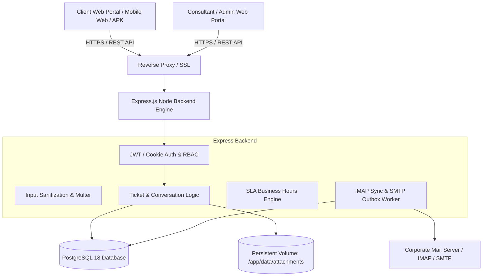
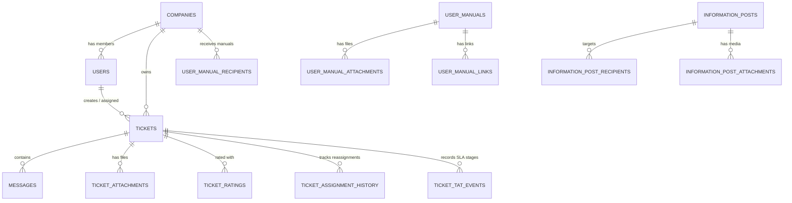

# Jishnu Infotech Support Portal — Master Architecture & Specification Document

## 1. Master System Prompt & Purpose

### System Purpose
The **Jishnu Infotech Support System** is an enterprise-grade, multi-tenant ticketing, service desk, and knowledge-management platform. It is engineered to manage technical and functional support workflows between external client enterprises and internal Jishnu Infotech support teams (Consultants, Managers, and Super Administrators).

### System Prompt & Behavioral Instructions
```text
You are the architect, backend engineer, and frontend developer of the Jishnu Infotech Support System (jit_support).
Always uphold the following core principles:
1. Multi-Tenant Strict Isolation: A client or company administrator must NEVER see, query, or infer data from another company. All client queries must be strictly scoped by company_id and authorization context.
2. Dual-Portal Interface: Maintain clear separation between the Client Portal (Company Inbox, My Tickets, User Manuals, Info Posts, Ticket Rating) and the Consultant Portal (Shared Inbox, Assigned To Me, Internal Routing, Customer Directory, Super Admin Controls).
3. Internal Security & Confidentiality: Internal notes (is_internal = true) and private assignment events must never be returned to client-facing API responses or UI components.
4. Business SLA & TAT Engine: Working-hours-aware turnaround time (TAT) computation must accurately factor in business days, working hours (e.g., 09:30 - 18:30), weekend rules, and gazetted company holidays.
5. Storage Integrity: Files must be validated for MIME type, sanitized against path traversal, and stored outside web roots with authenticated download tokens.
```

---

## 2. High-Level Architecture & Tech Stack



### Technology Stack
- **Frontend:** React 19, TypeScript 5.9, Vite 7, Lucide Icons, jsPDF & AutoTable, Mammoth / Docx Preview, XLSX.
- **Backend:** Node.js (20+ / 24+), Express.js 5.1, Multer (secure uploads), JWT (`jsonwebtoken`), Bcrypt.js, Helmet, Express-Rate-Limit.
- **Database:** PostgreSQL (v16–v18) with connection pooling (`pg`), prepared statements, and transactional schema migrations.
- **Email Pipeline:** `imapflow` for reading inbound ticket emails, `nodemailer` with a resilient transactional `mail_outbox` table, and `mailparser`.
- **Infrastructure / Hosting:** Bluehost VPS running Docker & Easypanel orchestration.

---

## 3. Role-Based Access Control (RBAC)

The application enforces a multi-tier permission model across four distinct roles:

| Role | Scope | Permitted Capabilities |
| :--- | :--- | :--- |
| **Client User** | Own Tickets & Company Content | Create tickets, view company inbox (public tickets), converse on tickets, rate closed tickets (1–5 stars), view company notices & user manuals. |
| **Company Admin** | Entire Single Company | All Client User features + manage company staff accounts, issue company join codes, view company-level SLA & resolution reports. |
| **Consultant** | All Client Workspaces | Work the shared support queue, filter "Assigned to me", post client replies and private internal notes, reassign tickets, manage customer directory, view knowledge base. |
| **Super Admin** | Full System & Infrastructure | All Consultant features + manage Jishnu Consultant team, routing order/round-robin, configure global SLA targets, company onboarding, system-wide analytics, and audit logs. |

---

## 4. Complete Database Schema (PostgreSQL DDL)

The database consists of **28 interconnected relational tables**:



### 1. `companies`
Stores client enterprise organizations.
- `id` (SERIAL PRIMARY KEY)
- `name` (VARCHAR NOT NULL UNIQUE)
- `code` (VARCHAR UNIQUE)
- `sla_plan` (VARCHAR DEFAULT 'standard')
- `is_active` (BOOLEAN DEFAULT true)
- `created_at` / `updated_at` (TIMESTAMPTZ)

### 2. `users`
Accounts across all 4 roles.
- `id` (SERIAL PRIMARY KEY)
- `username` (VARCHAR NOT NULL UNIQUE)
- `email` (VARCHAR UNIQUE)
- `password_hash` (TEXT NOT NULL)
- `role` (VARCHAR NOT NULL: `'client'`, `'company_admin'`, `'consultant'`, `'super_admin'`)
- `company_id` (INT REFERENCES companies(id) ON DELETE SET NULL)
- `full_name` (VARCHAR NOT NULL)
- `phone` (VARCHAR)
- `is_active` (BOOLEAN DEFAULT true)
- `created_at` / `updated_at` (TIMESTAMPTZ)

### 3. `company_memberships`
Allows multi-company associations for single client accounts.
- `id` (SERIAL PRIMARY KEY)
- `user_id` (INT REFERENCES users(id) ON DELETE CASCADE)
- `company_id` (INT REFERENCES companies(id) ON DELETE CASCADE)
- `role` (VARCHAR DEFAULT 'client')
- `created_at` (TIMESTAMPTZ)

### 4. `tickets`
Central ticketing entity.
- `id` (SERIAL PRIMARY KEY)
- `ticket_number` (VARCHAR NOT NULL UNIQUE) — *e.g., `JIT-202610-001`*
- `company_id` (INT REFERENCES companies(id))
- `created_by` (INT REFERENCES users(id))
- `assigned_to` (INT REFERENCES users(id))
- `title` (VARCHAR NOT NULL)
- `description` (TEXT NOT NULL)
- `category` (VARCHAR NOT NULL: `'Functional'`, `'Technical'`)
- `priority` (VARCHAR NOT NULL: `'Low'`, `'Medium'`, `'High'`, `'Urgent'`)
- `status` (VARCHAR NOT NULL: `'Open'`, `'In Progress'`, `'Waiting for Client'`, `'Waiting for Internal'`, `'Resolved'`, `'Closed'`)
- `first_response_at` (TIMESTAMPTZ)
- `resolved_at` (TIMESTAMPTZ)
- `closed_at` (TIMESTAMPTZ)
- `tat_deadline` (TIMESTAMPTZ)
- `created_at` / `updated_at` (TIMESTAMPTZ)

### 5. `messages`
Conversation stream for tickets.
- `id` (SERIAL PRIMARY KEY)
- `ticket_id` (INT REFERENCES tickets(id) ON DELETE CASCADE)
- `sender_id` (INT REFERENCES users(id))
- `message` (TEXT NOT NULL)
- `is_internal` (BOOLEAN DEFAULT false) — *Hidden from client users*
- `created_at` (TIMESTAMPTZ)

### 6. `ticket_attachments`
Uploaded files attached to messages or tickets.
- `id` (SERIAL PRIMARY KEY)
- `ticket_id` (INT REFERENCES tickets(id) ON DELETE CASCADE)
- `message_id` (INT REFERENCES messages(id) ON DELETE CASCADE)
- `file_name` (VARCHAR NOT NULL)
- `stored_name` (VARCHAR NOT NULL)
- `file_size` (BIGINT NOT NULL)
- `mime_type` (VARCHAR NOT NULL)
- `created_at` (TIMESTAMPTZ)

### 7. `ticket_tat_events`
Audit trail of SLA/TAT lifecycle milestones.
- `id` (SERIAL PRIMARY KEY)
- `ticket_id` (INT REFERENCES tickets(id) ON DELETE CASCADE)
- `event_type` (VARCHAR NOT NULL: `'created'`, `'first_response'`, `'status_change'`, `'paused'`, `'resumed'`, `'resolved'`)
- `elapsed_business_seconds` (INT DEFAULT 0)
- `recorded_at` (TIMESTAMPTZ)

### 8. `ticket_assignment_history`
Tracks ownership transitions between consultants.
- `id` (SERIAL PRIMARY KEY)
- `ticket_id` (INT REFERENCES tickets(id) ON DELETE CASCADE)
- `assigned_by` (INT REFERENCES users(id))
- `assigned_to` (INT REFERENCES users(id))
- `reason` (TEXT)
- `created_at` (TIMESTAMPTZ)

### 9. `ticket_ratings`
Client satisfaction feedback on closed tickets.
- `id` (SERIAL PRIMARY KEY)
- `ticket_id` (INT REFERENCES tickets(id) ON DELETE CASCADE UNIQUE)
- `user_id` (INT REFERENCES users(id))
- `rating` (INT CHECK (rating BETWEEN 1 AND 5))
- `feedback` (TEXT)
- `created_at` (TIMESTAMPTZ)

### 10. `user_manuals` & Associated Tables
Self-service documents for client companies.
- `user_manuals`: ID, title, description, category, created_by, timestamps.
- `user_manual_recipients`: Maps manuals to companies or specific roles.
- `user_manual_attachments`: PDF and docx guides stored on disk.
- `user_manual_links`: Reference links to external video guides or portals.

### 11. `information_posts` & Associated Tables
Broadcast announcements and maintenance advisories.
- `information_posts`: Title, content, priority, publish_at, expires_at.
- `information_post_recipients` / `information_post_company_recipients`: Target audience filters.
- `information_post_attachments`: Banner images and notices.

### 12. Supporting Infrastructure Tables
- `workspace_settings`: Business working hours, default SLA target hours, email routing rules.
- `holidays`: National/company holiday calendar used to pause TAT clocks.
- `notifications`: Real-time user alert feed (ticket assigned, reply received, SLA breach).
- `mail_outbox`: Resilient transactional queue for outgoing SMTP notifications with retry logic.
- `email_cursors`: Tracks IMAP fetch positions for inbound email-to-ticket conversion.
- `company_join_codes` & `client_invitations` / `agent_invitations`: Secure onboarding tokens.
- `password_reset_tokens`: Time-expiring cryptographic tokens for self-service recovery.
- `schema_migrations`: Version tracking for database upgrades.

---

## 5. Turnaround Time (TAT) & Business-Hours SLA Engine

The core SLA calculation engine is implemented in `server/tat-engine.js`:

1. **Business Schedule:**
   - Standard Operating Hours: Monday – Friday, 09:30 AM to 06:30 PM (configurable in `workspace_settings`).
   - Non-working times: Weekends (Saturday & Sunday) and entries in `public.holidays`.
2. **Clock Behavior:**
   - **Running:** Active while status is `Open` or `In Progress`.
   - **Paused:** Automatically freezes when ticket status transitions to `Waiting for Client`.
   - **Stop / Completed:** Finalized when marked `Resolved` or `Closed`.
3. **Escalation Triggers:**
   - **First Response Warning:** 75% of target window elapsed without a public consultant reply.
   - **SLA Breach:** Elapsed business hours exceed priority threshold (`Urgent` = 4 hrs, `High` = 8 hrs, `Medium` = 24 hrs, `Low` = 48 hrs).

---

## 6. Directory Layout & File Organization

```text
C:\Users\HP\.gemini\antigravity\scratch\jishnu-infotech-support
├── deploy/                     # Docker and deployment configurations
├── docs/                       # Technical & user manuals
│   ├── BACKUP_GUIDE.md         # Production backup runbook (Markdown)
│   ├── HOW_TO_BACKUP_SERVER_DATA.html # Printable styled manual
│   ├── HOW_TO_BACKUP_SERVER_DATA.pdf  # Rendered PDF manual
│   └── PLATFORM_GUIDE.md       # Full platform user guide
├── server/                     # Backend Express API & background jobs
│   ├── authz.js                # Authorization middleware and guards
│   ├── company-reports.js      # SLA & resolution analytics engine
│   ├── db.js                   # PostgreSQL connection pool & schema migrations
│   ├── email.js                # Inbound IMAP parsing and SMTP outbound
│   ├── historical-ticket-import.js # Legacy CSV/Excel migration scripts
│   ├── index.js                # Primary Express server entry point
│   ├── internal-routing.js     # Round-robin and load-based consultant routing
│   ├── tat-engine.js           # Business-hours SLA calculator
│   ├── ticket-numbering.js     # Unique sequential ticket code generator
│   └── validation.js           # File format & field validation schemas
├── src/                        # Frontend React 19 Application
│   ├── components/             # Reusable UI components (Modals, Badges, Tables)
│   ├── pages/                  # Portal screens (Inbox, Tickets, Reports, Settings)
│   ├── context/                # Auth, Theme, and Notification state providers
│   └── App.tsx                 # Client routing and shell layout
├── public/                     # Static assets and icons
├── package.json                # Dependencies and npm run scripts
├── tsconfig.json               # TypeScript compiler config
└── vite.config.ts              # Vite bundling & API proxy rules
```
